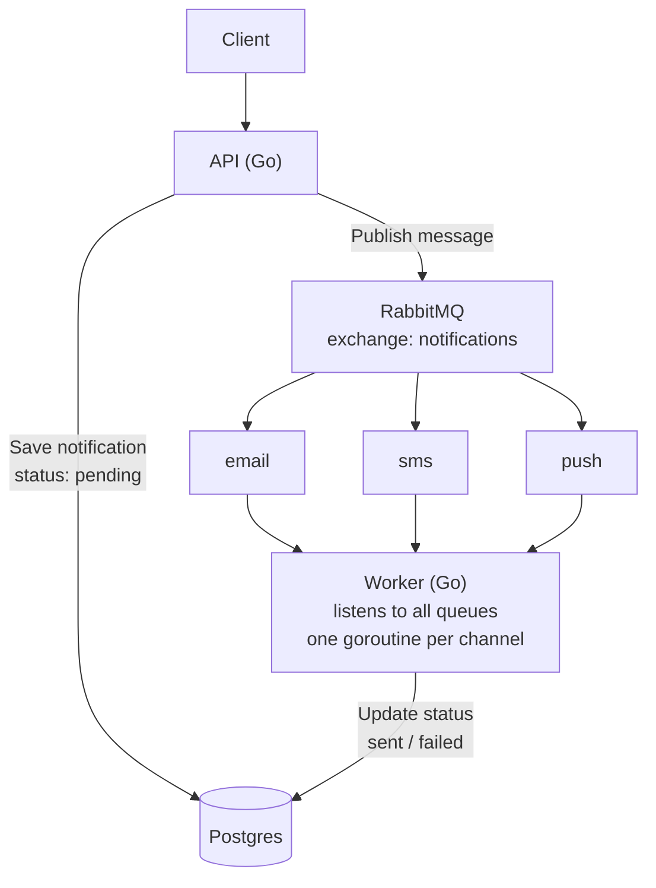

# Notification Service

Асинхронный сервис уведомлений: email, SMS, push. Пишем на Go, в качестве очереди используем RabbitMQ, данные храним в Postgres. Запускается через Docker.

## Общая схема



## Ключевые моменты

- **Два бинарника**: `cmd/api` и `cmd/worker`. Собираются из одного Dockerfile, можно отдельно масштабировать воркеров (`--scale worker=N`).
- **Надёжность**: запись в Postgres происходит до публикации в очередь. Воркер при обработке перечитывает последнее состояние из БД — если вдруг что-то изменили между публикацией и обработкой, не сломается.
- **Ретраи**: при ошибке отправки сообщение уходит в retry-очередь с задержкой (`RETRY_DELAY_MS`). ТTL на сообщении, после истечения RabbitMQ сам возвращает его в основную очередь.
- **Мёртвые письма**: если уведомление не отправили за `MAX_ATTEMPTS` попыток — помечаем `failed` и складываем в отдельную очередь `notifications.failed`, чтобы можно было разобрать вручную.
- **Шаблоны**: можно сохранить шаблон один раз, а потом создавать уведомления через `template_name` + `template_data`. Подстановка простая: `{{ключ}}`.

## Стек

| Компонент       | Что используем                       |
|-----------------|--------------------------------------|
| Язык            | Go 1.22                              |
| HTTP            | chi                                  |
| Очередь         | RabbitMQ (amqp091-go)                |
| БД              | PostgreSQL 16 (pgx/v5, пуллинг)       |
| Email           | net/smtp, в dev MailHog               |
| SMS             | HTTP-провайдер, совместимый с Twilio  |
| Push            | FCM (legacy HTTP)                    |
| Контейнеризация | Docker + Compose                     |

## Запуск

```bash
git clone <repo>
cd notification-service
cp .env.example .env  # поправьте параметры под себя

go mod tidy

docker compose up --build
```

После старта:
- API: http://localhost:8080
- RabbitMQ UI: http://localhost:15672 (guest/guest)
- Письма (MailHog): http://localhost:8025

## Примеры запросов

### Создать уведомление

```bash
curl -X POST http://localhost:8080/api/v1/notifications \
  -H "Content-Type: application/json" \
  -d '{
        "channel": "email",
        "recipient": "user@example.com",
        "subject": "Добро пожаловать",
        "body": "Спасибо за регистрацию!"
      }'
```

Ответ 202:
```json
{
  "id": "b1f3c2...",
  "channel": "email",
  "recipient": "user@example.com",
  "status": "pending",
  "attempts": 0,
  "max_attempts": 3,
  "created_at": "2026-07-27T10:00:00Z"
}
```

### Проверить статус

```bash
curl http://localhost:8080/api/v1/notifications/{id}
```

### Список с фильтром

```bash
curl "http://localhost:8080/api/v1/notifications?status=failed&limit=20"
```

### Шаблоны

```bash
curl -X POST http://localhost:8080/api/v1/templates \
  -H "Content-Type: application/json" \
  -d '{
        "name": "order_confirmation",
        "channel": "sms",
        "body": "Заказ {{order_id}} подтверждён, курьер приедет через {{eta}}."
      }'

curl -X POST http://localhost:8080/api/v1/notifications \
  -H "Content-Type: application/json" \
  -d '{
        "channel": "sms",
        "recipient": "+79001234567",
        "template_name": "order_confirmation",
        "template_data": {"order_id": "12345", "eta": "30 минут"}
      }'
```

## Структура проекта

```
cmd/
  api/       запуск HTTP API
  worker/    запуск воркера (consumer RabbitMQ)
internal/
  api/       роутер и хендлеры
  config/    загрузка конфига из env
  models/    доменные сущности и DTO
  queue/     работа с RabbitMQ, топология
  repository/ доступ к Postgres
  sender/    провайдеры доставки (email, sms, push)
  service/   основная логика
migrations/  SQL миграции
```
